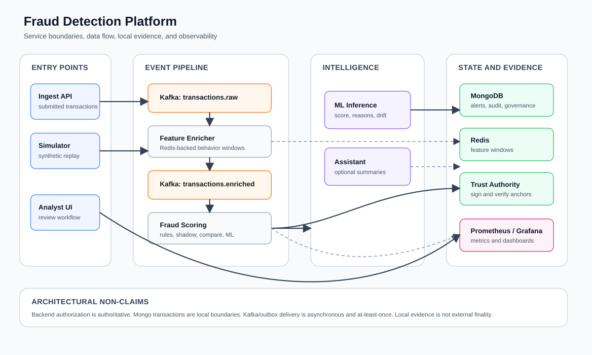
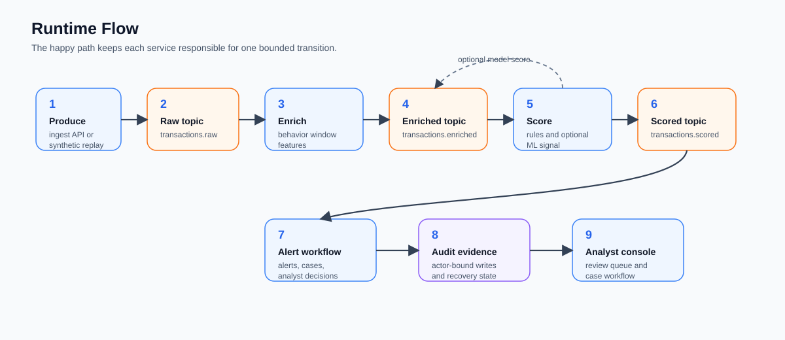
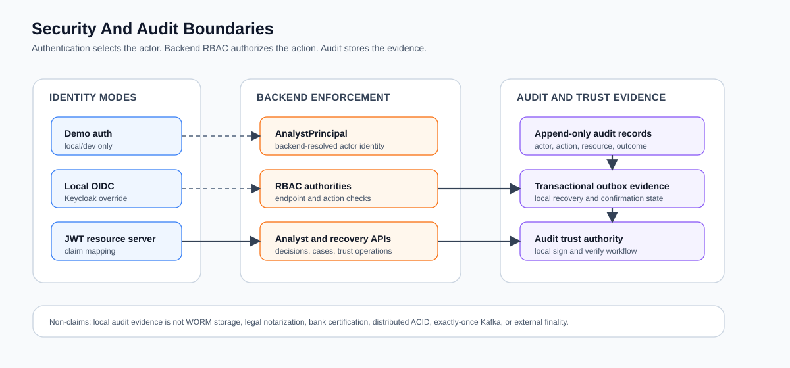

# Fraud Detection Platform

Production-style fraud detection platform implemented as a multi-service monorepo. The system ingests or generates
transactions, enriches them with behavioral features, scores fraud risk, creates analyst alerts and fraud cases, and
supports secured analyst workflows with RBAC, audit logging, evidence tracking, and local observability.

The repository intentionally uses platform-owned synthetic data. Third-party fraud datasets should stay local and
outside public Git history.

## Contents

- [System Overview](#system-overview)
- [Architecture](#architecture)
- [Runtime Flow](#runtime-flow)
- [Security And Audit Boundaries](#security-and-audit-boundaries)
- [Local Development](#local-development)
- [Services And Ports](#services-and-ports)
- [Testing](#testing)
- [Documentation Map](#documentation-map)
- [Project Layout](#project-layout)
- [Production Posture](#production-posture)

## System Overview

The platform is built around explicit service ownership and event-driven handoff:

| Area | Owner | Responsibility |
| --- | --- | --- |
| Transaction ingestion | `transaction-ingest-service` | REST entry point for submitted transactions. |
| Synthetic replay | `transaction-simulator-service` | Local/demo traffic generation from synthetic scenarios. |
| Feature enrichment | `feature-enricher-service` | Redis-backed feature windows and derived fraud signals. |
| Fraud scoring | `fraud-scoring-service` | Rule scoring plus ML integration in rule, shadow, ML, or compare modes. |
| ML runtime | `ml-inference-service` | Python model inference, governance snapshots, drift and advisory endpoints. |
| Alert workflow | `alert-service` | Alerts, fraud cases, analyst decisions, RBAC, audit, recovery, and regulated mutation controls. |
| Trust authority | `audit-trust-authority` | Local signing and verification authority for audit anchor material. |
| Analyst UI | `analyst-console-ui` | React console for monitoring, alert review, case workflow, and security UX. |
| Shared contracts | `common-events` | Kafka event contracts and shared value objects. |

Core capabilities:

- Kafka-based transaction pipeline with bounded local service responsibilities.
- Fraud scoring with deterministic rule mode and ML-assisted modes.
- Alert and fraud-case workflows for analyst review.
- Backend-authoritative RBAC and frontend session-aware UX.
- Append-only platform audit records and local trust-authority signing.
- Local Prometheus/Grafana observability.
- CI evidence mapping and branch-evidence governance for FDP work.

## Architecture



Design boundaries:

- Kafka contracts live in `common-events`.
- REST DTOs and persistence models stay service-local unless deliberately promoted.
- Backend authorization is authoritative; frontend gating is only UX.
- Mongo transaction mode provides atomicity within each service's local persistence boundary.
- Kafka/outbox delivery remains asynchronous and at-least-once unless a later implemented control proves otherwise.

## Runtime Flow



Risk scoring modes:

| Mode | Final score owner | Purpose |
| --- | --- | --- |
| `RULE_BASED` | Java rules | Deterministic default scoring. |
| `SHADOW` | Java rules | Keep Java rules authoritative while attaching ML diagnostics. |
| `COMPARE` | Java rules | Compare rules and ML for operational analysis. |
| `ML` | Python model | Use ML result with rule fallback when unavailable. |

## Security And Audit Boundaries



Security model:

- Demo auth is local/dev only and guarded by profile checks.
- Local OIDC uses Keycloak through the Docker override.
- JWT Resource Server support maps external claims into `AnalystPrincipal`.
- The authenticated principal is the authoritative actor identity for secured write paths.
- RBAC authorities protect analyst, audit, recovery, outbox, and trust incident endpoints.

Audit and trust model:

- Analyst write actions and governance advisory reviews are persisted as append-only audit records.
- Regulated mutation and outbox controls provide local evidence and recovery guarantees.
- The local trust authority signs and verifies audit anchor material for local proof workflows.

These are bounded local controls. The platform does not provide distributed ACID across services. It does not provide exactly-once Kafka delivery. Local append-only persistence and local signing are not independently operated external trust anchoring, certified WORM storage, certified retention, legal notarization, or regulatory certification. Integrity hashes establish local tamper evidence; they are not proof of external authenticity.

Start with:

- [Security architecture](docs/security/security_architecture.md)
- [Current architecture](docs/architecture/current_architecture.md)
- [Alert service source of truth](docs/architecture/alert_service_source_of_truth.md)
- [Public API semantics](docs/api/public_api_semantics.md)

## Local Development

Docker is the supported local runtime path for this README.

### Quick Start

Prerequisites are Docker with Compose, OpenSSL, Python 3.12+ available as `python`, and GNU Make. On Linux, macOS, WSL, or Git Bash, from a fresh clone:

```bash
make up
```

On Windows, install Docker Desktop, Git for Windows, and Python 3.12+ available as `python`, then run the equivalent one-command startup from PowerShell:

```powershell
.\scripts\app.cmd up
```

The Windows launcher uses Git for Windows to run the existing OpenSSL-based fixture generator and starts the
same Compose overlay combination as `make up`. From Git Bash installations that omit GNU Make, use
`./scripts/app.cmd up`.

OpenSSL generates local identity fixture material. Private PEM keys remain in ignored local directories.

Local startup runs the Python generator before Docker Compose starts, so `python` must be available on the host.

### Most Complete Local Security Demonstration Stack

`make up`, or `.\scripts\app.cmd up` on Windows, starts the most complete local security demonstration stack
currently provided by the repository. It:

- creates `deployment/.env` from `deployment/.env.example` if it is missing;
- validates existing local mTLS, JWT, and evaluation fixtures and generates them under
  `deployment/.local/` and `deployment/local-generated/` only when they are missing or invalid;
- starts OIDC browser login, mTLS internal calls to ML, JWT identity for the local trust authority, local
  observability, and the application container hardening overlay.

`deployment/.local/` is ignored by Git and excluded from Docker build contexts. Generated private keys stay on
the local workstation. Ordinary startup preserves valid identity material; intentionally rotate service-identity
fixtures with `make regenerate-local-runtime-fixtures`. The separate local model-promotion policy key and public
registry are created by `node scripts/bootstrap-local-model-promotion-keys.mjs --ensure`; only the public registry
is mounted into `alert-service`. This local key does not supply institutional policy approval.

`make up` and `.\scripts\app.cmd up` generate the local Shadow Performance Summary artifact before starting
Docker Compose. For manual inspection, the equivalent Compose startup after running
`make shadow-performance-summary` is:

```bash
docker compose --project-name fraud-detection-platform --env-file deployment/.env \
  -f deployment/docker-compose.yml \
  -f deployment/docker-compose.dev.yml \
  -f deployment/docker-compose.oidc.yml \
  -f deployment/docker-compose.service-identity-mtls.yml \
  -f deployment/docker-compose.trust-authority-jwt.yml \
  -f deployment/docker-compose.model-promotion-policy-trust.yml \
  -f deployment/docker-compose.hardened.yml \
  -f deployment/docker-compose.shadow-performance-generated.yml \
  up --build -d
```

The Shadow Performance dashboard uses the artifact-backed current provider. The official full local launchers include
`deployment/docker-compose.shadow-performance-generated.yml` and expose only the manifest-validated generated artifact.
Startup requires the generated artifact and reports `Generated Shadow Performance Summary not found. Run: make shadow-performance-summary` when generation has not produced it.
An unavailable or invalid artifact is reported as unavailable rather than being replaced with synthetic metrics.
The base runtime is fail-closed by default: without an explicitly configured current summary source, the endpoint returns `404`. The separate demo fixture metrics are not production current summary evidence.

The local launcher intentionally combines local generation before Compose, generated runtime mount, and shared global workspace counters as UI context. Governance metrics and authority come exclusively from the validated `ShadowPerformanceSummary`. Global counters in the Shadow Performance workspace are shell-level context only: they are not part of `ShadowPerformanceSummary`, not model evaluation metrics, not promotion readiness, not threshold recommendation, not production decisioning, not payment authorization, and not analyst recommendation logic. They are not generated by Python, read by the artifact provider, or returned by the current summary endpoint.

To run the explicit generated-artifact path directly:

```bash
make shadow-performance-summary
make app-up-shadow-performance-generated
```

The generated runtime mounts `deployment/local-generated/shadow-performance` read-only into
`/run/shadow-performance`, including canonical `current-summary.json` and sibling `manifest.json`. Artifact generation completes on the host before Docker Compose starts.

The separate demo override `deployment/docker-compose.shadow-performance-demo.yml` remains available only for the
canonical demo artifact-set path and is scoped to local visualization with no governance authority.

Exact-model evidence is an explicit opt-in. On Linux or WSL backed by a Linux filesystem with POSIX ACL support, start the same stack with the additional read-only reader overlay:

```bash
make up-exact-model-shadow
```

Fixture bootstrap provisions the root and its exact read-only ACL for container UID `10001`; unsupported filesystems fail closed. The exact-model reader selects one immutable M/V/F/SHA/window tuple: model name, model version, feature-contract version, model artifact SHA-256, and optional evaluation window. Runtime verifies the selected artifact and manifest bytes. `VERIFIED_AGAINST_SOURCE_BYTES` means the upstream publication boundary verified the source dataset bytes; `CLAIM_ONLY` carries only the source identity claim and does not make that assertion. The response contains aggregate evaluation evidence and at most a bounded labeled-feedback cohort, never raw feedback. It makes no scoring-wide latency, fallback-rate, reason-distribution, automatic-promotion, threshold, payment, or decision-authority claim. The Makefile path performs the ACL, source-declaration, resolved-configuration, existing non-symlink root, and read-only mount preflight before Compose starts.

All supported Make targets use the Compose project name `fraud-detection-platform`. `make down` stops that
project without deleting named volumes; `make app-clean` is the explicit destructive local-volume cleanup.
Compose resolves `MODEL_SHADOW_PERFORMANCE_ARTIFACT_ROOT` from the shell and `deployment/.env`; the exact-reader
preflight validates that resolved source directly, including custom absolute paths and paths containing spaces.

`deployment/.env.example` is the committed local demo/evaluation configuration template; startup creates the ignored
`deployment/.env` copy when it is absent. Application startup guards reject demo internal-auth
patterns and local-HMAC trust-authority demo configuration outside `local`, `dev`, or `docker-local` profiles,
or an automated `test` context with an explicit fixture marker such as `LOCAL_FIXTURE_TEST_ENABLED=true`.
`deployment/.env.example` documents the expected variables.
Local fixture credentials are accepted only by the documented local profiles or an automated test context with the explicit fixture marker.

After startup, confirm container readiness:

```bash
make ps
```

On Windows, the equivalent status command is:

```powershell
.\scripts\app.cmd ps
```

Expected resolved security-relevant values for this exact command:

| Setting | Expected resolved value |
| --- | --- |
| `ml-inference-service.INTERNAL_AUTH_MODE` | `MTLS_SERVICE_IDENTITY` |
| `fraud-scoring-service.INTERNAL_AUTH_CLIENT_ENABLED` | `true` |
| `alert-service.INTERNAL_AUTH_CLIENT_ENABLED` | `true` |
| `alert-service.APP_SECURITY_DEMO_AUTH_ENABLED` | `false` |
| `alert-service.AUDIT_TRUST_AUTHORITY_ENABLED` | `true` |
| `alert-service.AUDIT_TRUST_AUTHORITY_SIGNING_REQUIRED` | `true` |
| `alert-service.MODEL_PROMOTION_TRUSTED_ISSUERS_PATH` | `/run/model-promotion-policy/trusted-issuers.json` (read-only public registry only) |
| `alert-service.MODEL_PROMOTION_TRUST_MIN_GENERATION` | `1` (local fixture floor; production requires protected monotonic floor) |
| `alert-service.ASSISTANT_MODE` | `DETERMINISTIC` |
| `analyst-console-ui` build arg `VITE_AUTH_PROVIDER` | `bff` |

CI renders this official complete local security demonstration combination and runs `scripts/check-compose-security-config.mjs`; a
wrong official overlay order that leaves local-only internal auth enabled fails that resolved-config assertion.

### Security Scope Of The Local Stack

The documented stack is a localhost-bound evaluation environment. Startup guards constrain fixture credentials to explicit local profiles, Keycloak supplies local OIDC, generated mTLS and JWT material supplies service identity, and the local trust authority signs audit anchors. A production deployment supplies managed secrets, production identity and PKI, independent trust anchoring, managed TLS termination, image provenance, regulated-data controls, and environment-specific infrastructure hardening.

CI adds repository vulnerability scanning for review visibility. Deployment provenance is established separately through digest pinning, SBOM and SLSA evidence, signed images, and automated dependency updates.

### Compose Overlay Order Matters

Compose applies later overlay values over earlier values. `docker-compose.dev.yml` intentionally selects
local-only ML authentication, while the mTLS overlay must come after it to produce
`INTERNAL_AUTH_MODE=MTLS_SERVICE_IDENTITY` in the complete local security demonstration stack.
Ollama and its model initialization are available through the explicit AI overlay.
Backend JVM tuning can be overridden using
`JAVA_TOOL_OPTIONS`; application images use an exec-form Java entrypoint.

Ollama is available only as an explicit local opt-in:

```bash
docker compose --project-name fraud-detection-platform --env-file deployment/.env \
  -f deployment/docker-compose.yml \
  -f deployment/docker-compose.dev.yml \
  -f deployment/docker-compose.ai.yml \
  up --build -d
```

Open:

- Analyst console: `http://localhost:4173`
- Alert service: `http://localhost:8085`
- ML inference service: `https://localhost:8090` (generated local demo CA from `deployment/.local/service-identity/mtls`; Compose verifies it in-container)
- Prometheus: `http://localhost:9090`
- Grafana: `http://localhost:3000` (initial local default: `admin` / `admin`; `grafana-data` retains password changes)
- Keycloak: `http://localhost:8086`

Local analyst-console users:

| Username | Password | Role |
| --- | --- | --- |
| `readonly` | `readonly` | `READ_ONLY_ANALYST` |
| `analyst` | `analyst` | `ANALYST` |
| `reviewer` | `reviewer` | `REVIEWER` |
| `opsadmin` | `opsadmin` | `FRAUD_OPS_ADMIN` |

These credentials are local-only and must not be reused outside local test environments.

### Persistent Local Data And Cleanup

Named volumes persist data between restarts:

| Volume | Persisted local material |
| --- | --- |
| `mongodb-data` | MongoDB databases used by alerts, ML governance and the local trust authority. |
| `redis-data` | Redis local state and Redis persistence files produced by the local container. |
| `prometheus-data` | Local metrics history. |
| `grafana-data` | Local Grafana state. |

Stop the complete local security demonstration stack while preserving local data:

```bash
make down
```

On Windows:

```powershell
.\scripts\app.cmd down
```

The equivalent manual command is:

```bash
docker compose --project-name fraud-detection-platform --env-file deployment/.env \
  -f deployment/docker-compose.yml \
  -f deployment/docker-compose.dev.yml \
  -f deployment/docker-compose.oidc.yml \
  -f deployment/docker-compose.service-identity-mtls.yml \
  -f deployment/docker-compose.trust-authority-jwt.yml \
  -f deployment/docker-compose.model-promotion-policy-trust.yml \
  -f deployment/docker-compose.hardened.yml \
  -f deployment/docker-compose.shadow-performance-generated.yml \
  down
```

Delete all named data volumes for the complete local security demonstration stack:

```bash
make app-clean
```

On Windows:

```powershell
.\scripts\app.cmd clean
```

The equivalent manual command is:

```bash
docker compose --project-name fraud-detection-platform --env-file deployment/.env \
  -f deployment/docker-compose.yml \
  -f deployment/docker-compose.dev.yml \
  -f deployment/docker-compose.oidc.yml \
  -f deployment/docker-compose.service-identity-mtls.yml \
  -f deployment/docker-compose.trust-authority-jwt.yml \
  -f deployment/docker-compose.model-promotion-policy-trust.yml \
  -f deployment/docker-compose.hardened.yml \
  -f deployment/docker-compose.shadow-performance-generated.yml \
  down -v
```

### Troubleshooting

- Docker with Compose, OpenSSL, Python 3.12+, and GNU Make are required for `make up`; the Windows launcher uses Bash and OpenSSL from Git for Windows as its platform-native entry point.
- Run `make regenerate-local-runtime-fixtures` to intentionally replace local certificate/JWT fixture material.
- `make app-clean` or `.\scripts\app.cmd clean` removes named local data volumes as well as stopping the demonstration stack.
- Run `bash scripts/bootstrap-local-fixtures.sh --ensure` before local fixture-dependent backend or ML identity tests.

## Services And Ports

These local bindings are supplied by `deployment/docker-compose.dev.yml`; the base file keeps core services internal to the Compose networks.

| Service | Local URL | Notes |
| --- | --- | --- |
| `analyst-console-ui` | `http://localhost:4173` | React analyst console served by nginx. |
| `transaction-ingest-service` | `http://localhost:8081` | REST transaction ingestion. |
| `transaction-simulator-service` | `http://localhost:8082` | Synthetic replay and generated traffic. |
| `feature-enricher-service` | `http://localhost:8083` | Feature windows and enrichment. |
| `fraud-scoring-service` | `http://localhost:8084` | Rule and ML-assisted scoring. |
| `alert-service` | `http://localhost:8085` | Alerts, cases, audit, RBAC, recovery APIs. |
| `ml-inference-service` | `https://localhost:8090` | Python inference and governance API over the documented stack's local demo TLS certificate. |
| `audit-trust-authority` | `http://localhost:8095` | Local audit-signing authority. |
| `keycloak` | `http://localhost:8086` | Keycloak dev-mode OIDC in the documented stack. |
| `kafka` | `127.0.0.1:9092` | Local broker. |
| `mongodb` | `127.0.0.1:27017` | Local persistence. |
| `redis` | `127.0.0.1:6379` | Feature windows and local state. |
| `prometheus` | `http://localhost:9090` | Metrics and alert rules. |
| `grafana` | `http://localhost:3000` | Provisioned dashboards. |

## Container Health

| Service | Endpoint | Auth behavior | Compose check |
| --- | --- | --- | --- |
| Java application services | `/actuator/health/readiness` | Actuator readiness exposure; alert permits this health route through its public technical security rule. | `curl -fsS` from the container |
| `ml-inference-service` | `/health` | Public technical health response; the mTLS overlay changes transport to HTTPS and checks it with the local CA. | Python `urllib.request` over HTTPS from the container |
| `analyst-console-ui` | `/` | Static nginx response only. | `wget` to `127.0.0.1:8080` from the container |
| Kafka, MongoDB, Redis | Native check | No application auth surface. | Broker/database/CLI command |
| Prometheus, Grafana, Keycloak | None configured | Supporting local services; Keycloak is started in dev mode. | Not health-gated by Compose |

## Testing

Backend:

```bash
bash scripts/bootstrap-local-fixtures.sh --ensure
mvn test
```

Single backend module:

```bash
mvn -pl alert-service -am test
```

Frontend:

```bash
cd analyst-console-ui
npm test
npm run build
```

ML service:

```bash
cd ml-inference-service
python -m unittest discover -s tests
python -m compileall app tests
```

Documentation and CI governance checks:

```bash
node scripts/check-doc-overclaims.mjs
node scripts/compare-ci-jobs.mjs
node scripts/check-scope-guard-helpers-smoke.mjs
```

Integration tests use Docker/Testcontainers where applicable and activate automatically when Docker is available.

## Documentation Map

The README is intentionally short. Detailed contracts live in focused documentation:

| Need | Start here |
| --- | --- |
| Current repository docs | [Documentation index](docs/index.md) |
| Architecture and diagrams | [Architecture documentation](docs/architecture/index.md) |
| API contracts and error semantics | [API documentation](docs/api/index.md) |
| Security, auth, RBAC, audit | [Security documentation](docs/security/index.md) |
| Fraud-case lifecycle | [Fraud case management](docs/product/fraud_case_management.md) |
| ML governance and drift | [ML governance and drift](docs/ml/ml_governance_drift_v1.md) |
| Observability | [Operations and observability](docs/observability/operations_observability_v2.md) |
| FDP branch records | [FDP branch evidence](docs/fdp/index.md) |
| CI evidence mapping | [CI evidence map](docs/ci_evidence_map.md) |
| Reviewer flow | [Reviewer checklist](docs/reviewer_checklist.md) |

## Project Layout

```text
common-events/                  Shared Kafka contracts and value objects
common-test-support/            Shared fixtures and Testcontainers helpers
transaction-ingest-service/      REST transaction ingestion
transaction-simulator-service/   Synthetic replay and generated traffic
feature-enricher-service/        Redis-backed feature enrichment
fraud-scoring-service/           Rule and ML-assisted scoring
ml-inference-service/            Python model inference and governance API
alert-service/                   Alerts, cases, audit, RBAC, recovery APIs
audit-trust-authority/           Local trust-signing authority
analyst-console-ui/              React analyst console
deployment/                      Docker Compose, service images, monitoring config
docs/                            Architecture, API, security, runbooks, FDP evidence
scripts/                         CI, docs, scope, and dataset helpers
```

## Production Posture

Implemented production-style foundations:

- Service boundaries with Kafka contracts and local persistence ownership.
- RBAC and backend-authoritative authorization for analyst workflows.
- Durable local audit records and bounded integrity/trust workflows.
- Regulated mutation, outbox, and recovery evidence for selected workflows.
- Local OIDC, service identity foundations, and mTLS-scoped internal calls.
- CI gates and documentation evidence for branch-level changes.

The local stack does not provide independent legal notarization, certified WORM storage, certified retention, regulatory certification, or production approval. Existing local immutability semantics are not certified WORM guarantees. Future production deployment may require separately validated notarization, retention, governance, independently operated trust controls, infrastructure transaction boundaries, and delivery guarantees matched to each integration. Current source-of-truth documents define only the implemented local controls and their evidence boundaries.

## Maintainer

Milosz Podsiadly  
[m.podsiadly99@gmail.com](mailto:m.podsiadly99@gmail.com)  
[GitHub - MiloszPodsiadly](https://github.com/MiloszPodsiadly)

## License

Licensed under the [MIT License](https://opensource.org/licenses/MIT).
