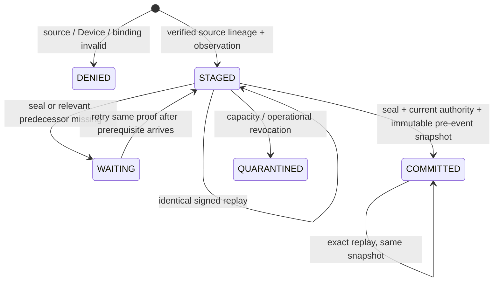

# Private verified Device admission and ledger v2

Date: 2026-11-14

Status: test-only implementation evidence in open PR #240, not synchronized with `master`. Exact SCORED binding and recovery evidence are covered in the linked private-diagnostic and resilience documents. Independent review, source-hierarchy reconciliation and production approval remain open. See [Device Verified Source Admission](../adr/device_verified_source_admission.md) for current release gates.

## Stage A boundary

`VerifiedDeviceAdmission` is a package-private adapter with no Spring bean or public endpoint. It accepts original source and Device assertion bytes, verifies their independent Ed25519 authorities, and reads the actual durable source RAW and ENRICHED lineage. It creates an opaque, adapter-owned in-memory ticket for `stage`, `seal`, and `commit`; a caller-built `Observation`, enum, guessed transaction ID, or a ticket from another adapter is not an admission input. Restart recovery re-verifies the same bytes and reconstructs a ticket.

The source read uses the existing `MongoSourceLineage.raw/enriched` checks. The read-only `enrichedBinding(receiptId, rawCommitment, enrichedCommitment)` reuses the same enriched-link and current receipt-policy validation for a single retained record without storing another RAW/ENRICHED payload copy. Stage A uses `enrichedBindings()` in bounded groups of at most 1,000 within a source snapshot; every receipt, lineage and grant is still checked, with no authorization reuse. Its result is a source fact reference, not permission to read Device history. The source reader and Device writer use different Mongo clients and privileges.

Expected institution, customer, device, source event, and transaction references are derived from the verified source scope and exact typed RAW event using a dedicated HMAC-SHA-256 pseudonym key. All inputs are length-delimited and separated by identifier-kind domains. UTF-8 encoding is strict: malformed UTF-16 is rejected instead of producing replacement bytes; well-formed Unicode is preserved exactly without normalization. Key version is independent of signing-key versions. `sourceCode` represents the entire domain-separated source-reference digest in base 36 with a fixed `S_` prefix, without truncation. Hashing caller fields authenticates nothing: an independently authorized Device assertion must bind the exact resulting pseudonyms, provider basis, receipt, RAW and ENRICHED commitments. Raw device flags, fingerprint, IP and `sourceSystem` do not authorize admission.

## Schema and identity change

The seven Device collections are `device_observation_candidates`, `device_observations`, `device_occurrences`, `device_history_member_anchors`, `device_source_coverage`, `device_scope_fences`, and `device_operational_revocation_tombstones`. There is no second ledger, Device payload outbox, new event, or Redis canonical history.

| Collection / path | Before | v2 |
| --- | --- | --- |
| All seven collections | No explicit source issuer/epoch in identities | Required `schemaVersion=2`, `identityVersion=2`, `sourceIssuer`, `sourceEpoch`, institution token and source code; strict Mongo validation and exact startup schema/index checks |
| `device_observation_candidates` | Event/transaction/sequence uniqueness within institution/source | Unique indexes also include issuer, epoch and identity version; immutable provenance references to receipt/RAW/ENRICHED/observation proof, population, signing key/policy and authorization grant; domain-separated HMACs authenticate candidate facts and lifecycle status/terminal metadata; `STAGED` has no TTL |
| `device_observations` | Institution/source/device/customer window | Same explicit epoch scope and pseudonym version in indexed predicates; authenticated provenance and a membership HMAC; live expiry is checked in queries |
| `device_occurrences` | Immutable serialized evidence and evidence commitment | Same snapshot plus source/Device provenance, coverage commitment and coverage signing-authority reference, authenticated by candidate, membership and snapshot HMACs; the current occurrence also holds a private count and HMAC commitment to the exact retained history members used by Stage A; no RAW/ENRICHED bytes or raw identifiers |
| `device_history_member_anchors` | New independent seal-membership reference | A separate HMAC-protected anchor for each candidate is inserted in the seal transaction; it retains no raw payload or original event ID and expires at `eventTime + 31 days + 5 minutes` |
| `device_source_coverage` | Structural contiguous sequence and watermark | Exact authorized population and sequence origin, signed coverage generation/previous commitment, exact ordered manifest commitment, signing-authority policy reference and a coverage HMAC |
| `device_scope_fences` | Institution/customer or institution/device IDs | Epoch-derived scope digest in every fence ID; explicit issuer/epoch metadata; stage, commit and revocation share the device fence |
| `device_operational_revocation_tombstones` | Institution/source/key/device ID | Epoch-scoped identity, no revocation inherited by another epoch; retained bounded tombstone lifetime remains unchanged |

Every institution/source compound identity/window index is prefixed by `sourceIssuer`, `sourceEpoch`, and `identityVersion`. Global aggregate pending-age and single-field TTL indexes remain global. Scope IDs use a domain-separated, length-delimited digest of `(sourceIssuer, institutionToken, sourceCode, sourceEpoch, identityVersion)`; event IDs additionally bind the source event key. Every scoped query uses the same tuple or its exact digest. Sequence reset or event-key reuse in another epoch cannot match old candidates, coverage, snapshots, fences, or revocations.

The Mongo validators require v2 identity fields and typed provenance. Nested provenance and coverage-authority records reject additional fields. Coverage generation zero represents unsealed staged work; any positive generation requires a watermark, coverage start, pseudonym version, signed assertion commitment and coverage-authority record. Missing legacy identity fields cannot be inferred on read or backfilled by startup. Existing compatible collections are validated without DDL writes, so a runtime writer needs no `createIndex`, `collMod` or collection-creation right.

## Signed coverage and immutable window

The coverage issuer signs a contractual, explicitly permitted population definition. The verifier pins its ID, definition version/commitment, inclusion/exclusion rules, sequence origin, earliest authorized coverage start, source scope and epoch. Cryptography authenticates that issuer's statement; it cannot prove upstream omissions did not occur.

For each coverage generation, `DeviceCoverageCommitment` commits the epoch scope, population policy, origin/from/through sequences, interval, watermark, pseudonym version, generation and previous commitment. It then commits ordered leaves `(sourceEventKey, sequence, immutable provenance commitment)` from the exact staged candidate batch. Mongo checks contiguous membership, candidate time/key bounds, no omitted earlier candidate, the previous generation, and equality with the signed manifest before advancing coverage.

The snapshot for event time `t` reads only `[t - 30 days, t)`. The current event does not count itself. A complete window requires an independently authorized continuous interval spanning the entire window and a verified sufficient seal. Cold start, insufficient interval, gaps, key discontinuity, invalidated coverage or unavailable authority never yield a fabricated zero count.

For supported history, Stage A commits to the exact union of prior observation members it uses, storing only a count and a domain-separated HMAC on the current immutable occurrence. Stage A compares observations, occurrences, committed candidates and independently sealed anchors. The private reader requires exact observation/occurrence/candidate membership and validates the current occurrence's membership commitment; Stage B has no anchor-collection access. Anchors expose no raw member IDs and create no second event-history ledger. They catch deletion of all three event copies before a later Stage A while an anchor and the application integrity key remain trusted. They do not prove that the source population is complete and do not survive deletion of the anchor too or compromise of the key. Rows without the anchor fail closed when their evidence claims supported history.

The adapter persists commitments and bounded policy/key references, not original source/assertion bytes or signature bytes. A domain-separated HMAC under the configured Device pseudonym key binds verified facts to their Mongo representation; the tag is an integrity check, not signing authority. Readers and writers fail closed when a tag is missing or invalid. Tags do not survive an unapproved key change, so a key rotation without authorized continuity makes dependent history unavailable. Stable signed proof time is retained for policy checks; the current verification clock is not part of replay identity. Current source receipt, Device observation grant and coverage signing grant are checked again before use, including after restart and when commit is attempted without calling `seal` again. Revoked historical observations make a new dependent window unavailable. Revoked current source/Device/coverage authority denies the effect or replay.

## Lifecycle and failure outcomes



These are private persistence/admission outcomes, not new public evidence states.

A committed Stage A replay returns `EXISTING` only while both the candidate and its current, unexpired occurrence are
present and their integrity checks pass. Missing candidate state returns `CANDIDATE_MISSING`; a surviving occurrence
alone does not establish a successful replay. This commit contract is distinct from Stage B, which requires an exact
initially published SCORED event binding. Publishing a SCORED event does not authorize a new Device commit or activate
Device scoring.

| Failure | Result |
| --- | --- |
| Wrong issuer/tenant/customer/device/epoch/receipt/RAW/ENRICHED or unsupported authority | Bounded denial before trusted staging |
| Same event/sequence/transaction with conflicting immutable facts | Permanent identity conflict; existing evidence is retained |
| Missing seal, sequence gap, relevant earlier event | Wait/reject; no guessed completeness |
| Signed manifest, generation or watermark inconsistent with staged batch | Seal conflict/regression; no coverage advancement |
| Coverage shorter than 30 days / epoch cold start | Immutable snapshot facts `UNAVAILABLE`, counts null |
| Historical source receipt or Device grant revoked | New dependent facts unavailable; no zero-history claim |
| Current source, Device or retained coverage signing grant revoked | Effect/replay denied, including a restart that skips seal |
| Operational device revocation | Shared epoch/device fence; quarantine staged work, remove live membership and invalidate coverage transactionally; no cross-epoch effect |
| Capacity exceeded | Quarantine and the one pending-counter decrement occur in the same transaction as the capacity decision |
| Transient write conflict | At most three transaction attempts; may report safely unresolved; explicit retry of the same input reconciles the durable terminal state |
| Unknown transaction commit acknowledgement | Retry only the same commit up to three times, then reconcile durable state; no distributed exactly-once claim |
| Incompatible validator/index/legacy row or unavailable Mongo | Fail startup/operation; no repair, default epoch or manual counter adjustment |

Source and Device authorization checks do not form a distributed serializable transaction. The adapter checks source authority before and after commit, and retained history is revalidated before use. The private diagnostic reader separately authorizes the actual SCORED event ID/createdAt/fingerprint and exact immutable snapshot, rechecking current authority. `DeviceRiskEvidence.occurrenceKey` and institution token alone remain insufficient authorization, including across epochs or scoring attempts.

## Migration and rollback

Bootstrap creates v2 only when none of the seven Device collections exists. Partial bootstrap, legacy collections, incompatible indexes/validators and rows bypassing validation block startup. Startup never drops, renames, rewrites or upgrades existing data. Production schema owners, retention disposition and maintenance inventory remain approval gates.

An offline migration must first stop Device writers/readers and keep admission/scoring disabled; inventory and back up the existing collections, index definitions and validators under the approved retention/access policy. A v1 source receipt may establish source identity, but cannot retroactively authenticate a Device observation that has no independent Device proof. Such rows cannot become trusted v2 history by assigning an epoch/version or copying their enum label. Resolve their retention/quarantine disposition explicitly. Re-admit original authorized Device proofs with exact durable source lineage into the existing collection namespace only after a reviewed cutover. No mixed v1/v2 writers or runtime dual ledger is supported.

Rollback keeps the private adapter disabled. Do not run v1 writers over v2 records or downgrade validators/indexes while accepting traffic. Restoring a reviewed pre-cutover backup is an offline operator action and restores no Device authority by itself. A partially created fresh schema also requires explicit inspection/recovery; the application will not silently complete or delete it. This branch executes no production data migration or deletion.

## Targeted evidence

`VerifiedDeviceAdmissionIntegrationTest` uses an authenticated Mongo replica set with disposable, independent Ed25519 source/Device/coverage keys. It calls the real ingest receipt owner, real source RAW binding, encrypted ENRICHED publication and fenced history-ack APIs. Feature-history contents are synthetic; this test does not claim real Kafka/Redis delivery. The Device runtime writer has only scoped Device collection privileges; the source reader cannot read Device collections, and neither can promote source receipts or modify schema.

Coverage includes exact signed replay after restart; stage/seal/commit restart boundaries; immutable prior-event counts; same-epoch event/sequence conflicts; epoch reset with reused IDs, old seal and revocation isolation; unknown population, manifest mismatch, gaps and predecessor waits; short coverage; tenant/customer/receipt/commitment injection; concurrent verified workers; source revocation; revoked retained coverage on restart; schema/index identity rejection; and runtime privilege denials. The actual Mongo `failCommand` failpoint injects `UnknownTransactionCommitResult` only for the Device writer application, and the test asserts it was consumed and produced one durable effect.

The existing structural foundation suite remains explicitly `UNTRUSTED_TEST_ONLY`. Its test-only authority stub is not a runtime bean/configuration default. Legacy/corruption cases intentionally use privileged validation bypass in fixtures to prove fail-start and no automatic repair. The capacity race test accepts only the documented bounded transient-conflict outcome and then verifies explicit replay, one terminal transition and one counter decrement.

Exact targeted command from the repository root:

```powershell
mvn "-Dmaven.repo.local=C:\Users\mpods\IdeaProjects\fraud-detection-platform\.m2repo" -pl feature-enricher-service -am "-Dsurefire.failIfNoSpecifiedTests=false" "-Dtest=VerifiedDeviceAdmissionIntegrationTest,MongoDeviceObservationStoreIntegrationTest,MongoDeviceObservationTransactionCommitTest,DeviceObservationStoreBoundaryTest,DeviceAssertionVerifierTest,DeviceRiskAdmissionConfigurationTest" test
```

The selected regression batch on 2026-11-12 finished **BUILD SUCCESS; 119 cases, 0 failures, 0 errors, 1 skipped**. All 118 non-optional cases executed. After the final strict UTF-8 mapping change, a focused run of `DevicePseudonymsTest,VerifiedDeviceAdmissionIntegrationTest` also finished **BUILD SUCCESS; 22 executed cases, 0 failures, 0 errors, 0 skipped**. These are historical results for that code state; reports were written to `feature-enricher-service/target/surefire-reports/`.

| Suite | Cases | Result |
| --- | --- | --- |
| `VerifiedDeviceAdmissionIntegrationTest` | 15 | All passed on authenticated Mongo replica set, including real unknown commit ACK and least-privilege checks |
| `MongoDeviceObservationStoreIntegrationTest` | 38 | 37 passed; the explicitly gated `boundedPreEventQueriesUseExpectedIndexesAtConfiguredCapacity` measurement was not enabled |
| `MongoDeviceObservationTransactionCommitTest` | 2 | Passed |
| `DeviceObservationStoreBoundaryTest` | 3 | Passed |
| `DeviceAssertionVerifierTest` | 57 | Passed |
| `DeviceRiskAdmissionConfigurationTest` | 4 | Passed |
| `DevicePseudonymsTest` | 7 | Passed in the final focused run; tenant/kind/framing separation, key copying, exact valid Unicode, malformed Unicode and input/key bounds |

The final focused command used the same Maven/module arguments above with `-Dtest=DevicePseudonymsTest,VerifiedDeviceAdmissionIntegrationTest`.

The focused Device/store regression selection on 2026-11-13 ran `VerifiedDeviceAdmissionIntegrationTest`,
`PrivateDeviceDiagnosticReaderIntegrationTest`, and `MongoDeviceObservationStoreIntegrationTest`: **68 tests, 0 failures,
0 errors, 2 explicitly opt-in skips; BUILD SUCCESS**. The broader targeted regression command on 2026-11-14 also
covered assertion verification, configuration fail-closed behavior, source lineage, exact SCORED lookup, and trace
context:

```powershell
mvn "-Dmaven.repo.local=$PWD\.m2repo" "-Dsurefire.failIfNoSpecifiedTests=false" -pl feature-enricher-service,source-persistence,transaction-ingest-service,alert-service -am "-Dtest=MongoDeviceObservationStoreIntegrationTest,VerifiedDeviceAdmissionIntegrationTest,PrivateDeviceDiagnosticReaderIntegrationTest,MongoDeviceObservationTransactionCommitTest,DeviceObservationStoreBoundaryTest,DeviceAssertionVerifierTest,DeviceEpochDigestTest,TraceContextTest,SourceScoredOccurrenceIntegrationTest,SourceLineagePipelineIntegrationTest,DeviceRiskAdmissionConfigurationTest" test
```

It finished **BUILD SUCCESS; 236 tests, 0 failures, 0 errors, 3 opt-in skips**. Both opt-in Stage A profiles at 100 and 500 members completed.
Stage A measured `stage` p50/p95 of 30.059/39.310 ms at 100 and 26.416/35.294 ms at 500; warm commit p50/p95/p99
was 73.806/105.651/118.013 ms at 100 and 135.234/216.839/286.730 ms at 500. Stage A at 1,000 was stopped after
the 500 checkpoint and is **NOT MEASURED**. The 10,000/25,000 high-density profiles and production capacity/SLO are
also **NOT MEASURED**. At 500, the four actual query plans used indexes and examined 500 documents / 1,000 keys each,
without `SORT` or `COLLSCAN`. Detailed environment, counts, commands and limitations are in the
[admission runbook](../runbooks/device_risk_admission.md). Full Maven `verify` remains a separate gate.

## Principal implementation touchpoints

- `feature-enricher-service/.../device/VerifiedDeviceAdmission.java`: actual source receipt/RAW/ENRICHED checks, independent Device proof, private tickets and replay.
- `DeviceEpoch.java`, `DevicePseudonyms.java`, `DeviceCoverageCommitment.java`: explicit epoch identity, dedicated keyed mapping and ordered signed-batch commitment.
- `DeviceObservationStore.java`, `MongoDeviceObservationStore.java`, `MongoDeviceObservationSchema.java`: immutable provenance, current signing authority, schema/index v2, fences, quarantine and Mongo transactions.
- `source-persistence/.../source/MongoSourceLineage.java`: exact read-only digest binding using the existing source authorization chain.
- `VerifiedDeviceAdmissionIntegrationTest.java`, `DeviceAuthenticatedMongo.java`, and test bridge `com.frauddetection.ingest.source.DeviceTestSourceReceipts`: actual test source ownership and separate scoped Mongo principals. The ingest module dependency is test-scoped only.

## Handoff

No production bean, issuer or pseudonym secret, active Device engine, public EI output, public event contract or fraud behavior is enabled. Primary Library documents, independent review, production key custody, source-population truth, legal/privacy retention, deployment roles and operator migration approval remain unresolved external gates. Exact published SCORED binding and private read-only diagnostic checks are recorded in [private diagnostics](device_private_diagnostics.md); recovery and lifecycle evidence is in [device_resilience.md](device_resilience.md).
